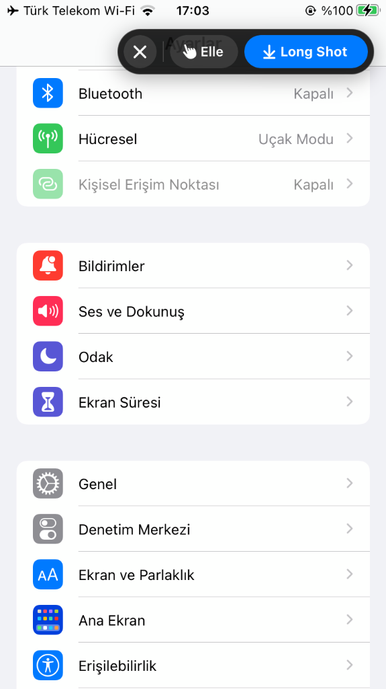
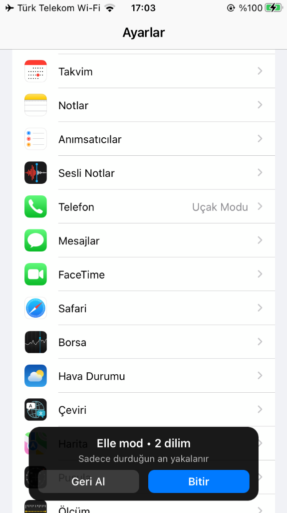
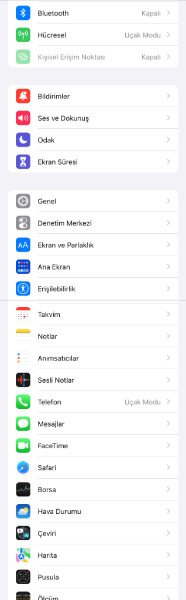
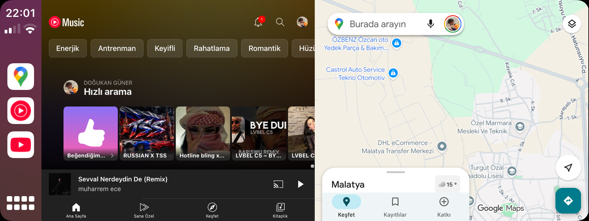
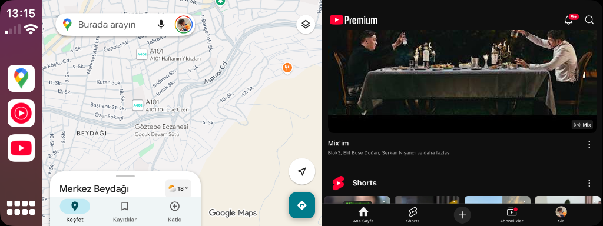
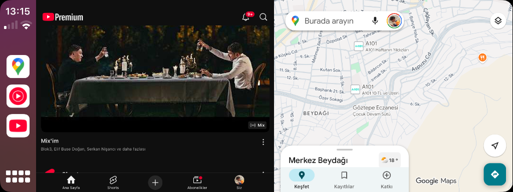
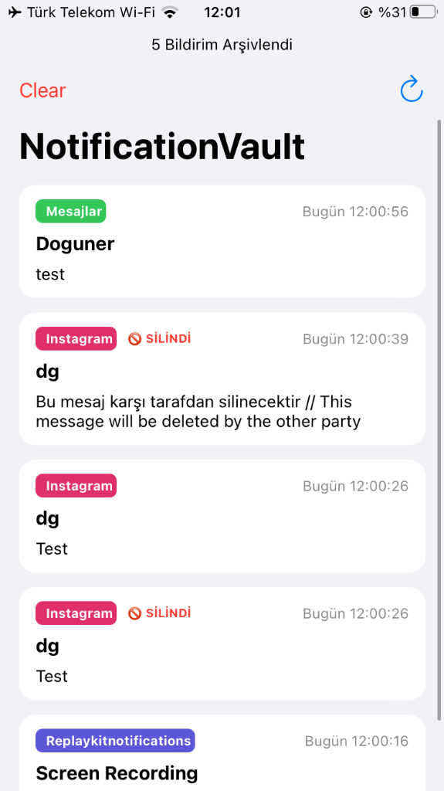
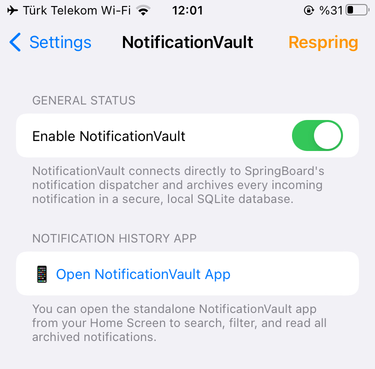
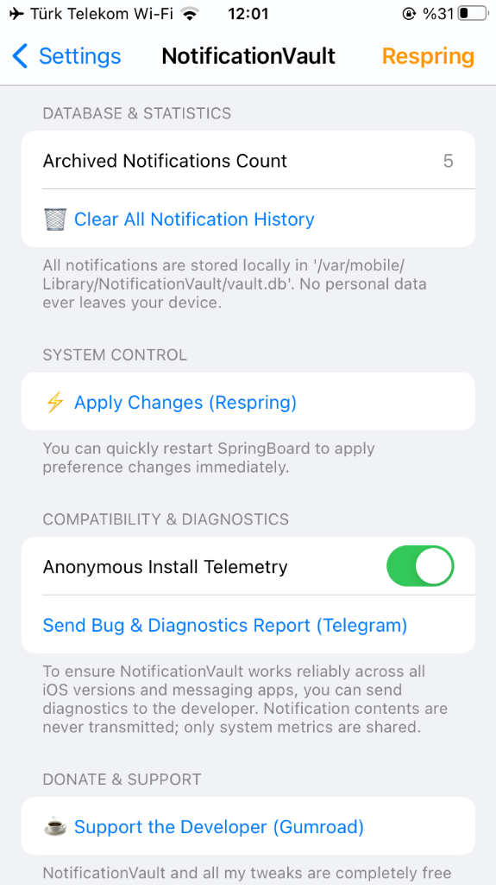

# 🛠️ Doguner Tweak Lab — Official iOS & CarPlay Tweaks

  
  
  
  

Official APT package repository for **LongShot** (intelligent long screenshot stitcher), **CarSplit** (CarPlay dual-app multitasking), and **NotificationVault** (offline anti-deletion notification archiver) for rootless iOS (`/var/jb`).

🌐 **Web Showcase:** [https://doguner1.github.io/repo/](https://doguner1.github.io/repo/)  
📦 **Add to Sileo / Zebra:** `https://doguner1.github.io/repo/`

---

## 📸 1. LongShot (v2.0.1)
Take seamless, high-resolution long / scrolling screenshots in any iOS application turn-by-turn with a single tap.

### 🖼️ How It Works (2-Step Capture)

  
  &nbsp;&nbsp;&nbsp;&nbsp;
  

  <i>(Step 1: Floating prompt capsule appears upon taking a screenshot • Step 2: Live slice counter and Stop HUD)</i>

### 📱 Output & Highlights

<table>
<tr>
<td width="38%" align="center" valign="top">
  
   <b>✨ Seamless Stitched Output (Long Shot)</b>
</td>
<td width="62%" valign="top">

### ✨ LongShot Architecture & Features
An intelligent stitching tweak that scrolls vertically elongated pages in iOS apps (Safari, Twitter/X, WhatsApp, Settings, Reddit, etc.) with a single tap to merge them into a single high-resolution vertical screenshot.

* **🚀 Auto & Manual Modes:** 'Long Shot' for fully automated scrolling, or 'Manual' for granular step-by-step control.
* **🛑 Live Stop Control:** No need to wait for the page bottom; tap 'Stop' anytime to immediately finalize and stitch slices up to that exact position without trailing blank space.
* **📊 Status Bar Header:** The real status bar (clock, battery, signal) is kept at the top of the stitched image; toggleable in Settings and on by default.
* **🖼️ Stock Thumbnail Suppression:** Automatically hides the stock iOS bottom-left screenshot thumbnail preview, restoring it instantly when disabled.
* **⚡ Fast Respring:** One-tap SpringBoard restart directly from the Settings menu and navigation bar.
* **💾 Photos Library & Native Sharing:** Saves directly to Photos and presents the native iOS Share Sheet (`UIActivityViewController`).
* **⚙️ Diagnostics & Support:** Send crash-free diagnostic reports directly to the developer via Telegram.
* **🛡️ Zero Crashes:** Safe runtime method hooks with complete isolation from headless system services.

</td>
</tr>
</table>

---

## 🚗 2. CarSplit (v1.0.0-beta6)
True side-by-side multitasking on **Apple CarPlay**. Run any two bridged applications simultaneously on your vehicle's head unit display—such as **Google Maps** on one side and **YouTube / Music** on the other.

### 📸 Real In-Car Vehicle Verification

Verified and tested on actual CarPlay vehicle displays:

  
  &nbsp;
  

  
  &nbsp;
  

  

  <i>Authentic CarPlay Screenshots: YouTube Music + Google Maps, Swapped Layouts, DeepSeek AI Assistant + Media, and Home Grid Multitasking.</i>

* **🏎️ True Multitasking:** Both apps remain fully active with independent dual-touch controls.
* **⏱️ One-Tap Clock Switch:** Tap the CarPlay status bar clock to cycle split layouts instantly.
* **⚠️ Requirement:** Requires **CarBridge** ([Havoc Repo](https://havoc.app/package/carbridge) / [carbridge.app](https://carbridge.app)).
* **📱 Verified Hardware:** 100% tested and verified on iPhone 7 (`iPhone9,3` on iOS 15.8.8) in an actual vehicle.

---

## 🔔 3. NotificationVault (v1.0.2)
Offline encrypted notification history vault and logger for iOS. Never miss a recalled or deleted message again. Captures all push and local alerts from WhatsApp, Instagram, Telegram, Messages, Mail, and more into a local SQLite database.

### 📸 Live Device Screenshots & Demo Video

  
  &nbsp;&nbsp;
  
  &nbsp;&nbsp;
  

  <i>(1. App Viewer with [Deleted] badges • 2. Settings Panel & Instant App Launcher • 3. SQLite Database Stats & Controls)</i>

  <a href="assets/notificationvault/demo.mp4"><b>▶️ Watch Live Video Demo (1.2 MB MP4)</b></a>

### ✨ NotificationVault Architecture & Features
* 🔒 **100% Offline & Private:** Zero cloud storage, zero telemetry leakage. Notifications never leave your local device storage.
* 🗑️ **Permanent Anti-Deletion Vault:** Even if the sender uses WhatsApp 'Delete for Everyone' or Instagram 'Unsend', NotificationVault permanently preserves the original message text and marks it with a distinct **[Deleted]** badge.
* 📱 **Dedicated Standalone Viewer App (`NotificationVault.app`):** Accessible directly from your Home Screen and Settings. Clean, searchable, and filterable notification history archive.
* 🌍 **Global 11-Language Localization:** English, Turkish, German, French, Spanish, Italian, Russian, Japanese, Simplified Chinese, Arabic, and Vietnamese.
* ⚙️ **Retina 29pt Settings Integration:** Full native settings management with instant database clear, telemetry toggle, and fast Respring.
* 🛡️ **100% Free Community Release:** Closed-source freeware, strictly non-commercial.

---

## 📱 Hardware & Firmware Compatibility

| Device / Firmware | Status | Verification Details |
|---|---|---|
| **iPhone 7 (`iPhone9,3`) — iOS 15.8.8** | ✅ **VERIFIED & TESTED** | Tested and verified in real vehicle CarPlay head unit and on-device screenshot capture. |
| **Other iPhone Models (A10 - A16)** | 🧪 **Community Beta** | Universal fat binaries (`arm64` + `arm64e`) for Dopamine 2 rootless. |
| **iOS 14.0 – 15.8.x – 16.x** | 🧪 **Community Beta** | Full rootless `/var/jb` compatibility across modern iOS versions. |

---

## 📦 How to Add to Sileo / Zebra

1. Open **Sileo** or **Zebra**.
2. Go to **Sources** → **Add** (`+`).
3. Enter: `https://doguner1.github.io/repo/`
4. Search for **NotificationVault**, **LongShot**, or **CarSplit** and install!

---

## ☕ Support the Developer

All tweaks from Doguner Tweak Lab are **100% free** with zero paywalls, ads, or tracking. If you enjoy these tweaks and want to support ongoing research and test hardware:

👉 [**Buy Me a Coffee on Gumroad**](https://aliciamaze.gumroad.com/l/doguner-tweak-lab)

---

## 📄 License & Community Notice

Strictly **FREE Community Edition**. If you purchased this anywhere, you were scammed!
Report pirated distributions and download official `.deb` releases only from this repo.
