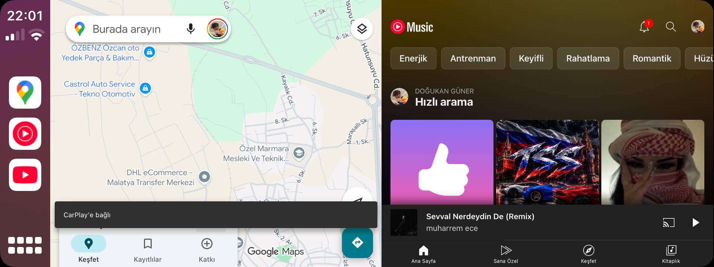
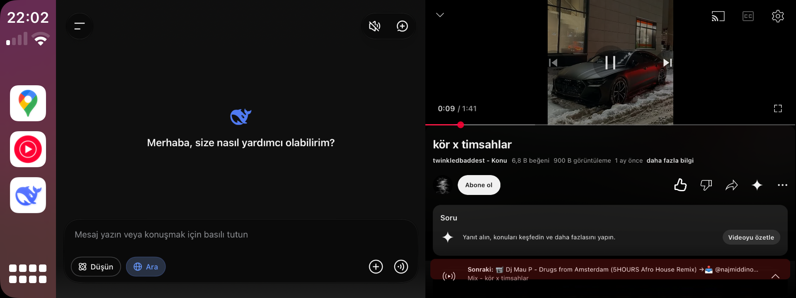

# 🛠️ Doguner Tweak Lab — Official iOS & CarPlay Tweaks

  
  
  
  

Official APT package repository for **LongShot** (intelligent long screenshot stitcher) and **CarSplit** (CarPlay dual-app multitasking) tweaks for rootless iOS (`/var/jb`).

🌐 **Web Showcase:** [https://doguner1.github.io/repo/](https://doguner1.github.io/repo/)  
📦 **Add to Sileo / Zebra:** `https://doguner1.github.io/repo/`

---

## 📸 1. LongShot (v1.0.0 — NEW)
Take seamless, high-resolution long / scrolling screenshots in any iOS application turn-by-turn with a single tap.

### 🖼️ Real Device Visual Comparison (Inputs & Stitched Output)

  
  &nbsp;&nbsp;
  
  &nbsp;&nbsp;
  

  <i>(Left: Trigger Prompt HUD • Center: Seamless Stitched Vertical Output • Right: Live Progress & Stop HUD)</i>

* **🚀 Auto Long Shot:** Automatically scrolls scrollable views (Safari, Twitter/X, WhatsApp, Settings, Reddit, etc.) and stitches slices into one continuous canvas.
* **🖐️ Manual ('Elle') Mode:** Floating capsule HUD allows step-by-step selective scrolling and capture.
* **🛑 Live Stop Button:** Hit *Durdur (Stop)* anytime to finalize and crop at that exact slice with zero blank trailing space.
* **🖼️ Suppress iOS Thumbnail:** Settings toggle to hide the stock iOS bottom-left corner screenshot preview.
* **💾 Native Save & Share:** Saves directly to Camera Roll and presents the native iOS Share Sheet.

---

## 🚗 2. CarSplit (v1.0.0-beta6)
True side-by-side multitasking on **Apple CarPlay**. Run any two bridged applications simultaneously on your vehicle's head unit display—such as **Google Maps** on one side and **YouTube / Music** on the other.

### 📸 Real In-Car Vehicle Verification

Verified and tested on actual CarPlay vehicle displays:

  
  &nbsp;
  

  
  &nbsp;
  

  

  <i>Authentic CarPlay Screenshots: YouTube Music + Google Maps, Swapped Layouts, DeepSeek AI Assistant + Media, and Home Grid Multitasking.</i>

* **🏎️ True Multitasking:** Both apps remain fully active with independent dual-touch controls.
* **⏱️ One-Tap Clock Switch:** Tap the CarPlay status bar clock to cycle split layouts instantly.
* **⚠️ Requirement:** Requires **CarBridge** ([Havoc Repo](https://havoc.app/package/carbridge) / [carbridge.app](https://carbridge.app)).
* **📱 Verified Hardware:** 100% tested and verified on iPhone 7 (`iPhone9,3` on iOS 15.8.8) in an actual vehicle.

---

## 📱 Hardware & Firmware Compatibility

| Device / Firmware | Status | Verification Details |
|---|---|---|
| **iPhone 7 (`iPhone9,3`) — iOS 15.8.8** | ✅ **VERIFIED & TESTED** | Tested and verified in real vehicle CarPlay head unit and on-device screenshot capture. |
| **Other iPhone Models (A10 - A16)** | 🧪 **Community Beta** | Universal fat binaries (`arm64` + `arm64e`) for Dopamine 2 rootless. |
| **iOS 14.0 – 15.8.x – 16.x** | 🧪 **Community Beta** | Full rootless `/var/jb` compatibility across modern iOS versions. |

---

## 📦 How to Add to Sileo / Zebra

1. Open **Sileo** or **Zebra**.
2. Go to **Sources** → **Add** (`+`).
3. Enter: `https://doguner1.github.io/repo/`
4. Search for `LongShot` or `CarSplit` and install!

---

## ☕ Support the Developer

All tweaks from Doguner Tweak Lab are **100% free** with zero paywalls, ads, or tracking. If you enjoy these tweaks and want to support ongoing research and test hardware:

👉 [**Buy Me a Coffee on Gumroad**](https://aliciamaze.gumroad.com/l/doguner-tweak-lab)

---

## 📄 License & Community Notice

Strictly **FREE Community Edition**. If you purchased this anywhere, you were scammed!
Report pirated distributions and download official `.deb` releases only from this repo.
